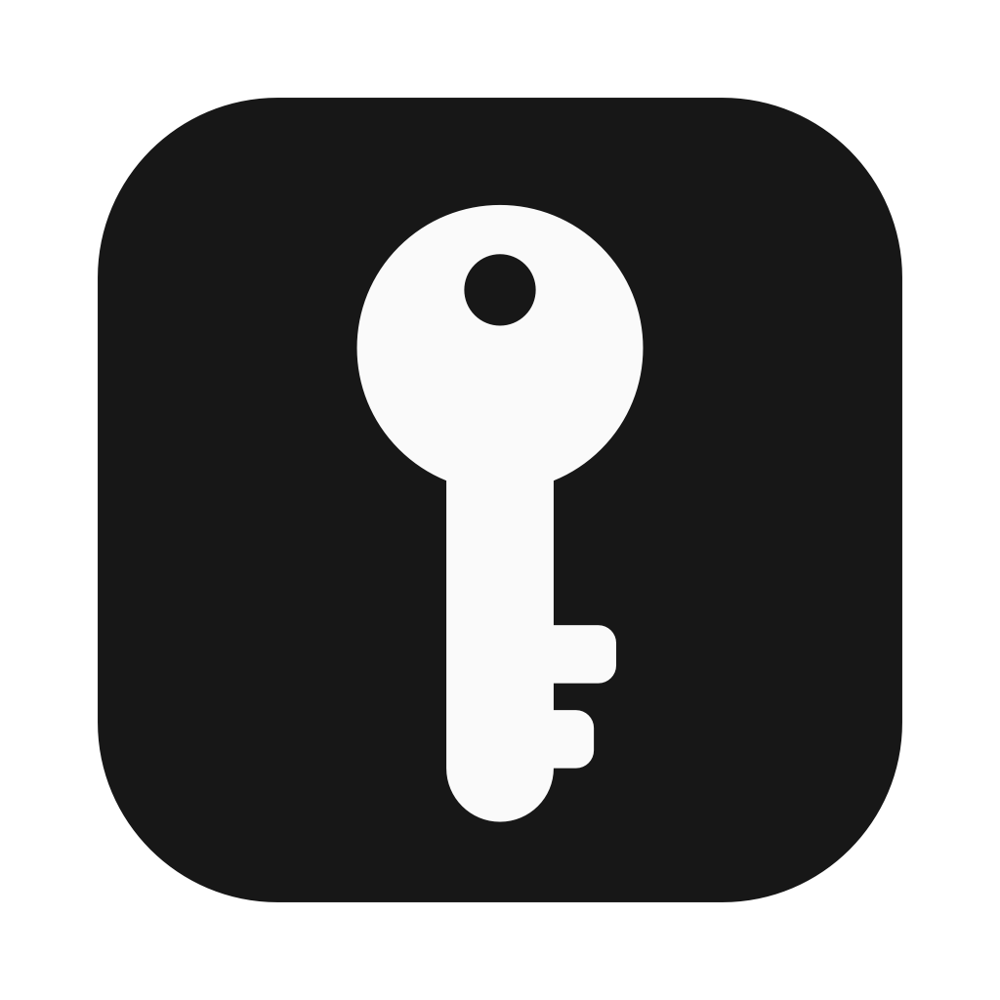

<div align="center">
  

  <h1>Keys</h1>

  <p>Everything you need to pick a project up again — context, environment variables, accesses and
  passwords — encrypted on your Mac and opened with Touch ID.</p>

  <p>
    <a href="https://github.com/guilhermekollet/keys/actions/workflows/ci.yml"></a>
    <a href="LICENSE"></a>
    
    
  </p>
</div>

Months after you last touched a project, a bug report arrives. Where is the code? How do you run
it? Which `.env` did production use? What was the database password, and why was it built this
way? Keys keeps those answers together, one project at a time, in a vault that never leaves your
Mac.

**Keys** is the app's name in every language but one: on a Mac set to Portuguese it is
**Chaves**, the word for both "keys" and the curly braces `{ }`, which is what its dotted icon
draws. The name follows the Mac's language, in the app and in Finder, the Dock and the menu bar.

> **Language note:** the app's interface follows your Mac's language: Portuguese (Brazil), English or
> Spanish, and English on a Mac set to any other language. The name does too: Chaves in
> Portuguese, Keys everywhere else. Code, comments and docs are in English.

## Contents

- [Features](#features)
- [How the vault is protected](#how-the-vault-is-protected)
- [Requirements](#requirements)
- [Getting started](#getting-started)
- [Development](#development)
- [Project layout](#project-layout)
- [Contributing](#contributing)
- [License](#license)

## Features

**Projects**
- **Projects inside projects**: a company and its products, a product and its services, as deep
  as you need. The sidebar shows the tree, each project shows the path above it and its
  subprojects, and searching a project also searches what's inside it. Deleting a project keeps
  its subprojects, one level up.
- A project per thing you maintain, with a symbol, a one-line summary, tags and a status:
  active, in maintenance, paused or archived.
- **Context**: free Markdown text for how to run it, how it's deployed, where things are, the
  decisions taken, gotchas and who to ask. An outline gets you started.
- The project's folder on your Mac, opened in Finder or Terminal with one click.
- **Links**: repository, production, dashboards, docs.

**Environment variables**
- One set per environment (development, staging, production…), edited in place.
- Import a `.env` file or paste one; values already there are updated, new keys added, and names
  like `*_TOKEN`, `*_SECRET` or `DATABASE_URL` are marked secret on the way in.
- Copy a whole set as `.env`, or save it as a file next to the code.

**Accesses**
- Dashboards, databases, servers, API keys and email accounts, with username, password, address and
  notes.
- A password generator without look-alike characters or quotes that break shells and `.env` files.

**Everyday details**
- Search everything from the sidebar: names, context, tags, links, variable names and usernames.
  Secret values are never searched.
- **The menu bar**: click the icon, click a project (and a subproject, if it has them), and search
  its accesses and variables; each one copies with a click, without opening the main window. Typing before choosing a project
  searches all of them (try "aurora prod database"). Esc goes back to the projects.
- Touch ID unlocks the vault for **2 hours**, then it locks and asks again (15 minutes to 8 hours,
  in **Ajustes**). It also locks when the Mac sleeps or the screen locks, unless you turn that
  off, and can lock sooner when the Mac sits idle.
- Secrets are copied as concealed, so clipboard managers skip them, and cleared after 30 seconds.

## How the vault is protected

| Piece | Where it lives |
| --- | --- |
| Projects, variables, accesses | One file, `~/Library/Application Support/Keys/vault.keys`, encrypted with ChaCha20-Poly1305 under a random 256-bit vault key. |
| The vault key | Inside the same file, sealed for the device key (P256 key agreement + HKDF-SHA256). |
| The device key | Created inside the Mac's **Secure Enclave**, which never lets it out. Using it requires Touch ID or the Mac's password. |
| The device key's handle | Your login Keychain. It is encrypted by the Secure Enclave and useless on any other Mac. |
| Automatic copies | `Backups/` next to the vault: the vault as it was before each session's first change, the 20 most recent, encrypted the same way (so they also open only on this Mac). |
| Exported backups | A `.keys-backup` file wherever you save it, sealed with ChaCha20-Poly1305 under a key derived from a password you choose (PBKDF2-HMAC-SHA256, 1,000,000 rounds, random salt). The password is never stored. |

There is no master password, no account and no server: nothing is sent anywhere. The flip side is
that **the vault itself only opens on the Mac that created it**: Migration Assistant or Time
Machine copy the file, but not the key in the Secure Enclave.

### Moving to another Mac

1. On the old Mac, **Ajustes › Backup e migração › Exportar backup…** (Settings › Backup and moving
   to another Mac › Export backup…). Choose a long password; the app writes a `.keys-backup` file.
2. Take the file to the new Mac (AirDrop, a USB drive, iCloud Drive: it's useless without the
   password).
3. On the new Mac, open the app and choose **Tenho um backup de outro Mac** (I have a backup from
   another Mac), or **Importar backup…** if it says the vault doesn't open there. Type the
   password: the backup becomes that Mac's vault, sealed for its own Secure Enclave key, and opens
   with its Touch ID from then on.

Importing into a vault that's already open merges: projects that aren't there come in, and a
project in both keeps whichever copy was changed last. Nothing is deleted. Export a backup now and
then and keep it off the Mac too: it's also what saves the vault if the Mac is lost.

See [SECURITY.md](SECURITY.md) for what this protects against, and what it doesn't.

## Requirements

- macOS 26 (Tahoe) or later on a Mac with a Secure Enclave (Apple silicon, or Intel with a T2 chip).
- To build from source: Swift 6.2 or later — Xcode 26, or the matching Command Line Tools.

## Getting started

```bash
git clone https://github.com/guilhermekollet/keys.git
cd keys
scripts/create-signing-cert.sh   # recommended, see "Signing" below
./build.sh
open build/Keys.app
```

On first launch, click **Criar cofre** (Create vault). From then on Keys opens with Touch ID (or the
Mac's password, on a Mac without Touch ID or with the lid closed). It lives in the Dock and in the
menu bar; closing the window keeps it in the menu bar.

On a MacBook with a notch, menu bar icons that don't fit are hidden behind it. Keys asks for a
place near the clock the first time; if it's still hidden, hold <kbd>⌘</kbd> and drag a few other
icons out of the menu bar.

### Signing

The Keychain remembers which app may read the device key's handle by its signature. An ad hoc
signature changes on every build, so macOS would ask again each time.
`scripts/create-signing-cert.sh` creates a self-signed certificate in your login keychain, which
`build.sh` uses automatically; choose **Always Allow** the first time macOS asks. To use another
identity, set `KEYS_SIGNING_IDENTITY`.

## Development

```bash
swift build                     # debug build
scripts/test.sh                 # tests (works with Xcode or with only the Command Line Tools)
./build.sh                      # release build and app bundle
open build/Keys.app --args --sample   # a made-up vault in memory: no Touch ID, nothing saved
build/Keys.app/Contents/MacOS/Keys --snapshot /tmp/keys-screens   # draw every screen to PNG and quit
KEYS_VAULT_DIR=/tmp/keys-dev open build/Keys.app   # a separate vault, to try things safely
```

`--sample` is the way to work on the interface without touching your vault, and `--snapshot` draws
each screen with it (main window per tab, lock screens, settings, menu bar panel, access editor)
without Touch ID or permission to record the screen. The translucent sidebar and toolbar come out
blank in those drawings; everything else is as on screen.

Keys shares Mara AI's design: near-black, off-white and lavender as the only accent, the system
font, pill-shaped buttons, icon tabs and a dot-matrix mark. The tokens and shared controls are in
`Sources/Keys/Theme.swift`.

## Project layout

```
Sources/Keys/
  KeysApp.swift              App entry point, main window, menu bar item, commands
  Vault.swift              The vault while the app runs: unlock, lock, saving, backups, auto-lock
  VaultFile.swift          The file format and its encryption
  VaultBackup.swift        Password-protected backups, for moving to another Mac, and merging them
  BackupViews.swift        Exporting and importing backups
  DeviceKey.swift          The Secure Enclave key and its handle in the Keychain
  Models.swift             Projects, environments, variables, accesses, search
  DotEnv.swift             Reading and writing .env files
  PasswordGenerator.swift  Random passwords
  Clipboard.swift          Concealed copies that clear themselves
  RootView.swift           Lock screen, sidebar and the split view
  ProjectView.swift        A project's header, context and links
  VariablesTab.swift       Environments and their variables, import and export
  CredentialsTab.swift     Accesses, their editor and the password generator
  MenuBarPanel.swift       Quick search from the menu bar
  SettingsView.swift       Settings
  Theme.swift              Colors, the dot-matrix mark and the shared controls (pills, cards, tabs)
  SampleVault.swift        The made-up vault behind --sample
  Snapshot.swift           --snapshot: draws every screen to PNG
  Localization.swift       Picks the interface language and the app's name; translations in Resources/*.lproj
Tests/KeysTests/           Swift Testing suite
scripts/                   Icon generation, signing, test runner, commit helper
```

## Contributing

Contributions are welcome. Read [CONTRIBUTING.md](CONTRIBUTING.md) to get set up, and the
[Code of Conduct](CODE_OF_CONDUCT.md). Found a security issue? See [SECURITY.md](SECURITY.md).

## License

[MIT](LICENSE) © Guilherme Kollet
